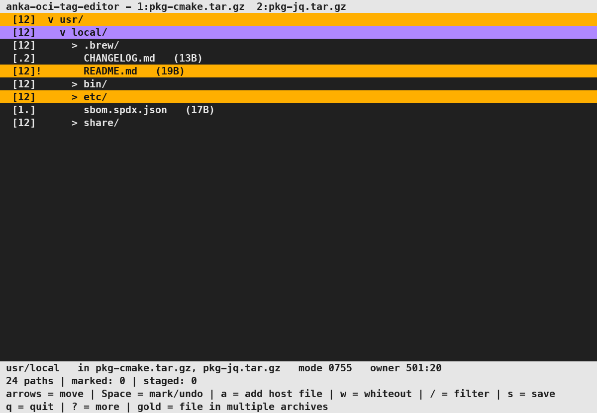
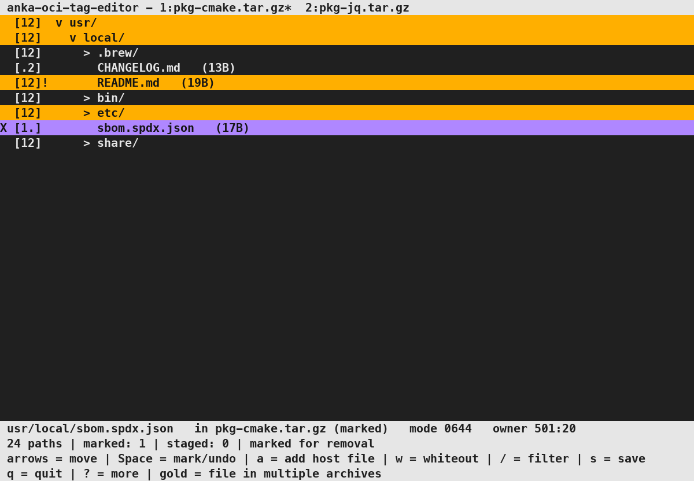
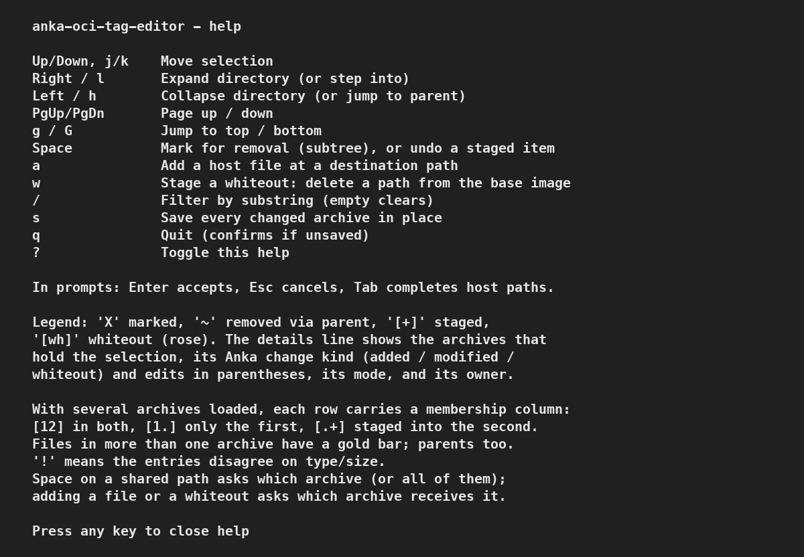
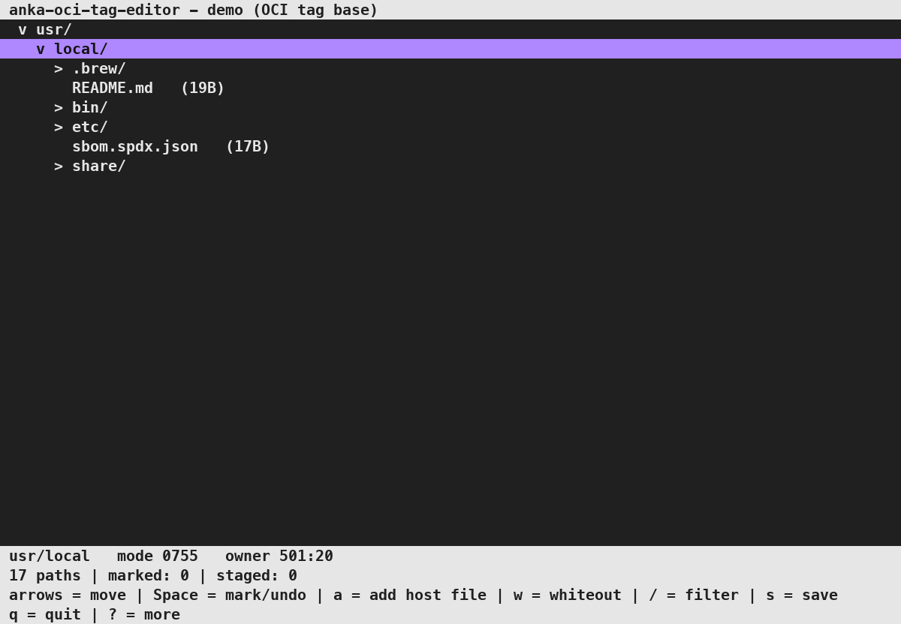

# anka-oci-tag-editor

[](https://github.com/veertuinc/anka-oci-tag-editor/actions/workflows/ci.yml)

`anka-oci-tag-editor` is a standalone terminal (TUI) tool for browsing and editing Anka
filesystem-layer archives (`.tar.gz`) before you import/push them. It lets you:

- Navigate the archive hierarchy, expanding and collapsing directories.
- Mark files or whole subtrees for removal from the archive.
- Add files from the host machine at a chosen path inside the archive.
- See whiteout (`.wh.`) entries, and stage new whiteouts that delete a path from the
  base image when Anka applies the layer.
- Undo a staged addition or whiteout before you save.
- Save the edited archive back in place (atomically), with the Anka change kind,
  owners, permissions, hard links, and pax records of kept entries unchanged.
- Open several layers at once (up to 8) and see which of them hold each path.
- Edit the top layer of a stopped VM's current
  [OCI tag](http://docs.veertu.com/anka/templates-and-registries/using-an-oci-registry/oci-tags/)
  with no exported tar, and save the edits as a new local OCI tag
  ([VM mode](#vm-mode)).

It is a **completely separate product**. It does not link against, include, or modify
any Anka code. In archive mode it only reads and writes a standard gzip tar, and you
run the Anka steps yourself. VM mode runs the `anka` command for you.

The file tree of two layers. Yellow rows are paths that both layers hold.



A file marked for removal. `X` is the mark.



The help overlay.



VM mode on a stopped VM. The header shows the current OCI tag.



Regenerate the pictures with `make screenshots` (needs `tmux`, `python3`, and Pillow). The letters are Menlo Bold on macOS, or DejaVu Sans Mono Bold on Linux. VM mode in that command uses the fake `anka` from the tests, so you do not need a VM. Commit the PNG files under `screenshots/`.

## Where it fits in the Anka workflow

```bash
# 1. Export a filesystem layer from your modified template (Anka)
anka export --layer mytemplate /path/to/layer.tar.gz

# 2. Curate the layer interactively (this tool; pass several layers to compare them)
anka-oci-tag-editor /path/to/layer.tar.gz

# 3. Restore the template and re-apply the edited layer (Anka)
anka pull --local mytemplate --tag vanilla --shrink
anka import --vmid mytemplate /path/to/layer.tar.gz

# 4. Push when satisfied (Anka)
anka push mytemplate --tag mylayer http://zot-registry:15455/v2
```

## Build

Requires a C toolchain, `zlib`, and `ncurses` (present by default on macOS). On
Debian or Ubuntu, install `build-essential libncurses-dev zlib1g-dev`. On Linux the
binary links `ncursesw`, so UTF-8 file names show correctly.

```bash
make               # builds the binary and runs the headless round-trip tests
make build         # binary only
make test          # tests only
```

The VM mode tests run fake `anka` and `anka_image` bash scripts from
[`tests/fake-anka/`](tests/fake-anka/). They do not need Anka.

This produces the `anka-oci-tag-editor` binary. To install:

```bash
sudo make install            # installs to /usr/local/bin
# or
make install PREFIX=~/.local
```

`make dev` builds the editor, opens the two sample layers, and restarts it when you change a file under `src/`. Quit with `q` or Ctrl-C. Pass other arguments with `make dev DEV_ARGS='layer.tar.gz'`. `make test-dev` checks in tmux that the keys work before and after a restart.

## CI

Pushes and pull requests to `edge` run GitHub Actions CI on `macos-latest` and
`ubuntu-24.04-arm` (`make EXTRA_CFLAGS=-Werror`: build + headless tests). A new
compiler warning fails the build.

## Release

Cut a release from the Actions tab: run the **Release** workflow and set
`version` to `MAJOR.MINOR.PATCH` (for example `1.0.0`). The workflow:

1. Builds and tests on macOS and Linux
2. Creates tag `vX.Y.Z` and a GitHub Release
3. Attaches `anka-oci-tag-editor-darwin-arm64` and `anka-oci-tag-editor-linux-arm64`

## Usage

```bash
anka-oci-tag-editor <archive1.tar.gz> [archive2.tar.gz archive3.tar.gz ...]
anka-oci-tag-editor --vm <name> [--tag <tag>]
```

### Keys

| Key | Action |
|-----|--------|
| Up / Down, `j` / `k` | Move selection |
| Right / `l` | Expand directory (or step into it) |
| Left / `h` | Collapse directory (or jump to parent) |
| PgUp / PgDn | Page up / down |
| `g` / `G` | Jump to top / bottom |
| `Space` | Toggle mark-for-removal on the selected file or subtree. On a staged item, undo it |
| `a` | Add a host file: prompts for the host path, the destination in the archive, and the owner |
| `w` | Stage a whiteout: prompts for the path to delete from the base image |
| `/` | Filter by substring (shows matching branches; an empty filter clears it) |
| `s` | Save every changed archive in place |
| `q` | Quit (asks to confirm if there are unsaved changes) |
| `?` | Toggle the help overlay |

In prompts, `Enter` accepts, `Esc` cancels, and `Tab` completes host paths. Prompts
start with a useful value: the selected directory for destinations and whiteouts,
the current filter, and the owner of the nearest entry above the destination.

Row markers:

- `X` is marked for removal, `~` is removed because a parent is marked.
- `[+]` is staged and not saved yet.
- `[wh]` (red) is a whiteout, with the name it deletes.
- `a -> b` is a symlink, `a => b` is a hard link.

The line above the status bar shows the selected path in full, the archives that
hold it, its mode, and its owner. After each archive name, the parentheses show
the Anka change kind (added, modified, or whiteout) and your edits (staged,
marked, or removed via parent). An archive with no change kind and no edit shows
only its name. With one archive open, the line shows only the state:

```text
 usr/local   in pkg-cmake.tar.gz, pkg-jq.tar.gz   mode 0755   owner 501:20
 usr/local/README.md   in pkg-cmake.tar.gz (marked), pkg-jq.tar.gz   mode 0644   owner 501:20
```

## Whiteouts

A layer entry whose name starts with `.wh.` tells Anka to delete the rest of the name
from the base image. For example, `usr/local/bin/.wh.tool` deletes
`usr/local/bin/tool`. The editor shows these entries as `[wh] tool` with a note:

```
      v bin/
          [wh] oldtool   (deletes it from the base image)
          [+] [wh] tool   (deletes it from the base image)
X         tool   (10B)
```

- Press `w` and type the path to delete. End the path with `/` to delete a directory.
  Anka removes a directory only when it is empty in the base image.
- If the layer also holds the path you delete, the editor marks that copy for removal,
  because a layer must not add and delete the same path. If the path was a staged
  addition, the addition is undone.
- Press `Space` on a staged whiteout to undo it. A mark that the whiteout set is
  cleared too.
- The editor writes a new whiteout as an empty entry with change kind 4 (whiteout),
  the same as `anka export --layer`.
- The opaque marker `.wh..wh..opq` shows as a whiteout row with a note. Anka does not
  use it.

Limits:

- If a whiteout undoes a staged addition, undoing the whiteout does not stage the
  addition again. Use `a` to add the host file again.
- The editor records that a whiteout marked its target. If you unmark the target and
  mark it again while the whiteout is staged, undoing the whiteout still clears that
  mark. Press `Space` on the target to mark it again.

## Comparing several layers

Pass more than one archive to browse them together:

```bash
anka-oci-tag-editor layer-a.tar.gz layer-b.tar.gz
```

Tiny Homebrew-style fixtures for trying this live are in [`testdata/`](testdata/)
(regenerate with `./testdata/build.sh`).

Every path appears once, and a membership column shows which archives hold it:

```
X [12]  v etc/          both archives contain etc/
  [1.]    > opt/        only the first archive
  [.2]    > var/        only the second archive
  [.+]      added.txt   staged into the second archive, not saved yet
```

Files that exist in more than one archive have a gold bar. Parent folders that lead to
such a file have it too, so you can expand down toward the overlap; folders that
merely appear in several archives without a shared file underneath stay normal. A
`!` after the column means the entries disagree about the entry's type or size.
Paths are matched by name only; file contents are never hashed or compared.

Edits stay scoped to an archive:

- `Space` on a path held by one archive marks it there directly. On a shared path it
  asks which archive to mark, or `a` for all of them.
- `a` asks which archive receives the new file, since an addition belongs to one tar.
- `s` writes every archive with unsaved changes and reports how many were saved. If one
  fails, saving stops there and the archives already written stay saved.

The header lists the loaded archives by number, with `*` marking unsaved changes.

## VM mode

```bash
anka-oci-tag-editor --vm <name> [--tag <tag>]
```

VM mode opens the top layer of a stopped VM's current
[OCI tag](http://docs.veertu.com/anka/templates-and-registries/using-an-oci-registry/oci-tags/).
You do not export a tar first. When you save, the editor applies your edits to the
VM's working disk and commits them as a new local OCI tag on top of the current OCI
tag.

What the editor does:

1. At open, it reads the layer from `ANKA_PUSH_MODE=2 anka export -t <tag> <vm>`
   through a pipe. It reads only the tar headers, so a large layer does not go to
   disk. Then it counts the changes on the working disk that are not in an OCI tag,
   with `anka_image diff -ln`.
2. `Space`, `a`, and `w` work as in archive mode, with one rule for `Space` (below).
3. `s` asks about the uncommitted disk changes, if there are some. Then it asks for
   the new OCI tag name. The default is `<tag>-edit`. A name that exists is refused
   before the disk changes.
4. It writes a small change tar: a whiteout for each marked path, deepest paths
   first, then the staged items. It sends the tar to `anka import -v <vm>` and runs
   `anka push -l -t <new tag> <vm>`. Then it loads the new OCI tag, which holds only
   your edits.

Ctrl-C has no effect while the import and the commit run.

Rules:

- The VM must be stopped. If you give `--tag`, it must be the VM's current OCI tag.
- `Space` works only on paths that the layer added: entries with change kind 1, and
  directory entries. Anka's diff writes a directory only when the base image does not
  have it. A changed file (kind 2) or a whiteout has a base version under it. A
  whiteout cannot bring that version back, so the editor shows "This entry has a base
  version; use w to delete it from the image".
- If the working disk has changes that are not in an OCI tag and you answer yes, they
  go into the new OCI tag too. If you answer no, the save stops.

If the import fails, the working disk can be partly changed, and your edits stay in
the editor. If the commit fails after a good import, your changes are on the working
disk, and the message gives the `anka push -l -t` command that commits them.

Limits:

- Each save makes a new OCI tag on top of the current OCI tag. Anka cannot replace
  the layer of an existing OCI tag, and `anka push -l` refuses a name that exists.
- A whiteout hides a file from the image. It does not free space: a file that the old
  OCI tag added stays inside that OCI tag's layer.
- One VM at a time. You cannot open a VM and archives together.
- The editor needs `anka` on `PATH`. It uses only the public `anka` CLI, except the
  dirty check, which runs the `anka_image` tool that `anka config` names.

A test with Anka 3.10 on a clone of a macOS 27.0.1 VM: the editor opened a 7-path
layer in about 4 seconds. A save with two removals and one new file took 16 seconds,
and the new OCI tag's layer held only those changes.

## How it works

- On open, each archive is scanned once and its entries are inserted into a single
  in-memory path tree (directories are inferred from entry paths). A path found in
  several archives becomes one node that records which archives hold it.
- Removal and staged additions are per-archive flags on tree nodes; a node is excluded
  from an archive on save if it or any of its ancestors is marked for that archive.
- Additions reference the host file by path and are read at save time. A new file gets
  its type from the host and its owner from the prompt. Anka imports an entry only
  when its change kind (the tar `devmajor` field) is allowed. Thus an addition that
  replaces a layer entry keeps the change kind of that entry. A new path stays
  untagged, so Anka always imports it.
- On save, the original archive is streamed entry-by-entry into a temporary file (kept
  entries copied, removed entries skipped), staged additions are appended, and the temp
  file is atomically renamed over the original. The temp file gets the mode of the original,
  and its owner when the user has permission. The original is left untouched unless the
  new archive is written successfully. Each archive is written independently, so an
  archive you did not change is never rewritten.
- Kept entries keep their change kind, owner names, hard links, device numbers, and pax
  records (for example `SCHILY.xattr.*` and sub-second times). If the editor cannot
  rewrite an entry, for example an unknown entry type with data, the save fails and
  the original archive does not change.

## Design notes

- Written in C using only system `zlib` (gzip) and `ncurses` (TUI).
- The tar reader/writer emits POSIX ustar headers with pax extension records for long
  paths / large sizes, matching what Anka's importer accepts. The reader also accepts
  global pax headers, GNU long names, and GNU base-256 sizes, and it checks each
  header checksum.
- No persisted edit state: closing without saving discards changes.
